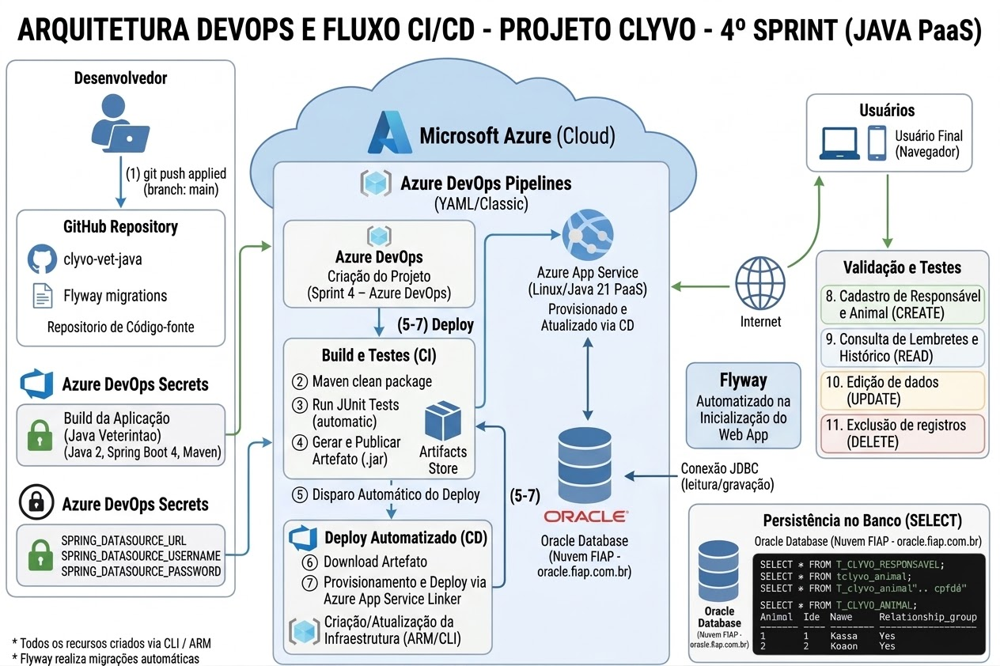

# Clyvo - Gestao Veterinaria (Deploy em Nuvem - Azure DevOps + Azure Web App)

Aplicacao web de gestao veterinaria desenvolvida em Java Advanced (Spring Boot, Thymeleaf e Spring Security) com banco de dados Oracle, implantada no Azure Web App com pipeline de CI/CD automatizado via Azure DevOps Pipelines.

## Indice

- Sobre o Projeto
- Beneficios para o Negocio
- Arquitetura
- Fluxo CI/CD
- Tecnologias Utilizadas
- Estrutura do Repositorio
- Funcionalidades
- Pre-requisitos
- Instalacao (How-To)
- Usuarios de Teste e Perfis de Acesso
- Testes do CRUD
- Seguranca
- Custos e Limpeza dos Recursos
- Integrantes

## Sobre o Projeto

O Clyvo acompanha a jornada de saude do pet de forma continua: cadastro de responsaveis, animais, veterinarios, doencas e vacinas, alem do agendamento de consultas e do controle de aplicacao de vacinas. A pagina inicial exibe um painel de lembretes com as vacinas que ainda tem doses pendentes e as consultas dos proximos 7 dias, e a tela de detalhes do animal reune o historico de vacinas, consultas e doencas.

O projeto foi desenvolvido na disciplina de Java Advanced (FIAP) como uma aplicacao web completa, com camadas de visualizacao (Thymeleaf), controle de versao de banco de dados (Flyway) e autenticacao/autorizacao por perfil (Spring Security). Nesta entrega, essa mesma aplicacao foi levada para a nuvem: o build, os testes e o deploy passaram a ser executados por pipelines no Azure DevOps, com publicacao automatica no Azure Web App e banco de dados Oracle hospedado na nuvem da FIAP.

## Beneficios para o Negocio

- Elimina o controle manual/em papel de fichas de animais, substituindo por um cadastro unico e consultavel a qualquer momento.
- Evita conflitos de agenda: o sistema impede que um mesmo veterinario tenha duas consultas marcadas na mesma data.
- Reduz risco a saude dos animais ao bloquear a reaplicacao indevida de uma vacina antes do prazo minimo entre doses e ao impedir que sejam aplicadas mais doses do que o previsto.
- Ajuda o responsavel a acompanhar a saude do pet, com lembretes de vacinas pendentes e consultas proximas, calculados individualmente para cada animal.
- Separa o acesso por perfil (administracao versus atendimento), reduzindo o risco de alteracoes indevidas em dados de cadastro (veterinarios, doencas, vacinas).
- Hospedar a aplicacao na nuvem elimina a necessidade de manter um servidor fisico na clinica, e o CI/CD faz o build, os testes e o deploy automaticamente a cada atualizacao de codigo, reduzindo o tempo entre o desenvolvimento e a entrega de melhorias.

## Arquitetura

- Opcao escolhida: Azure Web App (sem containerizacao)
- Banco de dados: Oracle Database, na nuvem da FIAP (oracle.fiap.com.br)
- Aplicacao: Java 21, Spring Boot 4, Spring MVC, Thymeleaf, Spring Security, Spring Data JPA
- Controle de versao do banco: Flyway
- Repositorio de codigo: GitHub, conectado ao Azure DevOps
- CI/CD: Azure DevOps Pipelines (YAML), com build Maven, testes automaticos, publicacao de artefato e deploy automatico
- Custo: Azure App Service Plan no tier F1 (gratuito), compativel com o limite do Azure for Students

A aplicacao segue arquitetura em camadas:

- **Control**: controllers Spring MVC, recebem requisicoes e retornam `ModelAndView` para as telas Thymeleaf.
- **Model**: entidades JPA que representam as tabelas do banco de dados, e a classe `LembreteVacina`, usada apenas para exibir os dados do painel de lembretes.
- **Repository**: interfaces Spring Data JPA para acesso ao banco.
- **Security**: configuracao do Spring Security, autenticacao e liberacao de rotas por perfil.
- **Templates (Thymeleaf)**: telas HTML da aplicacao.

Diagrama da arquitetura:



## Fluxo CI/CD

Personas: o **desenvolvedor**, que envia o codigo ao repositorio, e o **usuario final**, que acessa a aplicacao pelo navegador.

| Ordem | Etapa | Ferramenta |
|---|---|---|
| 1 | O desenvolvedor faz push na branch `main` | GitHub |
| 2 | O push dispara automaticamente a pipeline | Azure DevOps Pipelines |
| 3 | CI: build da aplicacao com Maven | Azure DevOps (agente ubuntu-latest) |
| 4 | CI: execucao dos testes automaticos | Maven + Azure DevOps |
| 5 | CI: geracao e publicacao do artefato (.jar) no Azure DevOps | Azure DevOps Artifacts |
| 6 | CD: disparado apos a geracao do novo artefato | Azure DevOps Pipelines |
| 7 | CD: deploy do artefato no Azure Web App | Azure Web App |
| 8 | A aplicacao em execucao consulta e grava dados no banco | Oracle (FIAP) |
| 9 | O usuario final acessa a aplicacao pelo navegador | Azure Web App |

## Tecnologias Utilizadas

- Java 21
- Spring Boot 4 (Spring MVC, Spring Data JPA, Spring Security)
- Thymeleaf
- Flyway
- Oracle Database
- Maven
- Azure CLI / Azure Cloud Shell
- Azure Web App (App Service)
- Azure DevOps (Pipelines e Artifacts, conectado ao GitHub)

## Estrutura do Repositorio

Esta entrega usa um unico repositorio: o Azure Web App recebe o pacote compilado da aplicacao diretamente, sem depender de imagens Docker separadas.

| Item | Conteudo |
|---|---|
| src/main/java | Codigo-fonte da aplicacao (Control, Model, Repository, Security) |
| src/main/resources/templates | Telas Thymeleaf |
| src/main/resources/db/migration | Scripts de migracao do Flyway (estrutura das tabelas, usuarios iniciais e dados de demonstracao) |
| src/main/resources/application.properties | Configuracoes da aplicacao, com a conexao do banco lida de variaveis de ambiente |
| pom.xml | Dependencias e configuracao de build do Maven |
| azure-pipelines.yml | Pipeline de CI/CD (YAML) |
| arquitetura-devops.jpg | Diagrama da arquitetura da solucao |

## Funcionalidades

- **Cadastros (CRUD completo)**: responsaveis, animais, veterinarios (somente ADMIN), doencas (somente ADMIN) e vacinas (somente ADMIN), com validacao dos dados (campos obrigatorios, CPF, e-mail e data de nascimento).
- **Agendamento de consultas**: vincula um animal a um veterinario em uma data futura, impedindo que o mesmo veterinario tenha duas consultas no mesmo dia.
- **Aplicacao de vacinas**: registra a aplicacao de uma vacina em um animal, impedindo a reaplicacao antes do prazo definido pela frequencia de doses e a aplicacao de mais doses do que o previsto.
- **Painel de lembretes**: na pagina inicial, mostra as vacinas com doses pendentes (doses aplicadas, doses restantes, proxima data e situacao, atrasada ou no prazo) e as consultas dos proximos 7 dias.
- **Historico do animal**: a tela de detalhes mostra a idade calculada a partir da data de nascimento e o historico de vacinas, consultas e doencas.

## Pre-requisitos

- Conta ativa no Microsoft Azure (utilizamos Azure for Students)
- Acesso ao Azure Cloud Shell
- Conta no Azure DevOps (https://dev.azure.com)
- Repositorio da aplicacao no GitHub
- Acesso a um banco de dados Oracle (utilizamos o disponibilizado pela FIAP)

## Instalacao (How-To)

### 1. Criar a infraestrutura no Azure (Azure Cloud Shell)

Antes de executar, confira se esta na assinatura correta:

```
az account show
az account list -o table
az account set --subscription "nome-da-assinatura-correta"
```

Defina as variaveis:

```
RESOURCE_GROUP_NAME="rg-clyvo-rm563000"
WEBAPP_NAME="app-clyvo-rm563000"
APP_SERVICE_PLAN="plan-clyvo-rm563000"
LOCATION="brazilsouth"
RUNTIME="JAVA:21-java21"
USERNAME="seu-usuario-oracle"
PASSWORD="sua-senha-oracle"
URL="jdbc:oracle:thin:@//oracle.fiap.com.br:1521/ORCL"
```

Registre os provedores, crie o grupo de recursos, o plano de servico e o Web App:

```
az provider register --namespace Microsoft.Web
az provider register --namespace Microsoft.ServiceLinker

az group create \
  --name $RESOURCE_GROUP_NAME \
  --location "$LOCATION"

az appservice plan create \
  --name $APP_SERVICE_PLAN \
  --resource-group $RESOURCE_GROUP_NAME \
  --location "$LOCATION" \
  --sku F1 \
  --is-linux

az webapp create \
  --name $WEBAPP_NAME \
  --resource-group $RESOURCE_GROUP_NAME \
  --plan $APP_SERVICE_PLAN \
  --runtime "$RUNTIME"
```

Configure as variaveis de ambiente do banco no Web App e reinicie:

```
az webapp config appsettings set \
  --name "$WEBAPP_NAME" \
  --resource-group "$RESOURCE_GROUP_NAME" \
  --settings \
    SPRING_DATASOURCE_USERNAME="$USERNAME" \
    SPRING_DATASOURCE_PASSWORD="$PASSWORD" \
    SPRING_DATASOURCE_URL="$URL"

az webapp restart --name $WEBAPP_NAME --resource-group $RESOURCE_GROUP_NAME
```

### 2. Criar o projeto no Azure DevOps

Em https://dev.azure.com, crie um novo projeto com as seguintes informacoes:

| Campo | Valor |
|---|---|
| Project name | Sprint 4 - Azure DevOps |
| Description | Projeto para entrega da Sprint 4 do professor, com a lista dos integrantes do grupo |
| Visibility | Private |
| Version control | Git |
| Work item process | Scrum |

### 3. Importar o repositorio GitHub do Java no Azure DevOps

https://github.com/enzovbernard/DevopsChallengeSprint4

### 4. Criar a Service Connection com o Azure

Em Project settings > Service connections > New service connection:

1. Escolha **Azure Resource Manager**
2. Escolha **Service principal (automatic)**
3. Selecione a assinatura e o grupo de recursos `rg-clyvo-rm563000`
4. Nomeie a conexao como `MyAzureSubscription`

### 5. Criar a pipeline

Em Pipelines > New pipeline:

1. Selecione **GitHub** como origem e autorize o Azure Pipelines
2. Escolha o repositorio `DevopsChallengeSprint4`
3. Escolha **Existing Azure Pipelines YAML file** e selecione `/azure-pipelines.yml`

Conteudo do arquivo `azure-pipelines.yml`, na raiz do repositorio:

```yaml
trigger:
  branches:
    include:
      - Main

pool:
  vmImage: 'ubuntu-latest'

variables:
  JAVA_VERSION: '17'
  JDK_VERSION: '1.17'
  WEB_APP_NAME: 'app-clyvo-rm563000'
  ARTIFACT_NAME: 'app'
  TEST_RUN_TITLE: 'Testes de Codigo'

stages:
  - stage: CI
    displayName: 'CI - Build e Testes'
    jobs:
      - job: Build
        displayName: 'Instalar e Configurar Java'
        steps:
          - task: JavaToolInstaller@0
            displayName: 'Configurar Java 17'
            inputs:
              versionSpec: $(JAVA_VERSION)
              jdkArchitectureOption: 'x64'
              jdkSourceOption: 'PreInstalled'

          - task: Maven@4
            displayName: 'Maven - Compilar e executar testes'
            inputs:
              mavenPomFile: 'pom.xml'
              goals: 'clean package'
              options: ''
              publishJUnitResults: true
              testResultsFiles: '**/surefire-reports/TEST-*.xml'
              testRunTitle: $(TEST_RUN_TITLE)
              javaHomeOption: 'JDKVersion'
              jdkVersionOption: $(JDK_VERSION)
              mavenVersionOption: 'Default'

          - task: CopyFiles@2
            displayName: 'Preparar artefato JAR'
            inputs:
              SourceFolder: '$(System.DefaultWorkingDirectory)'
              Contents: '**/target/*.jar'
              TargetFolder: '$(Build.ArtifactStagingDirectory)/$(ARTIFACT_NAME)'

          - task: PublishPipelineArtifact@1
            displayName: 'Publicar artefato app'
            inputs:
              targetPath: '$(Build.ArtifactStagingDirectory)/$(ARTIFACT_NAME)'
              artifact: '$(ARTIFACT_NAME)'
              publishLocation: 'pipeline'

  - stage: CD
    displayName: 'CD - Deploy no Azure Web App'
    dependsOn: CI
    condition: succeeded()
    jobs:
      - deployment: Deploy
        displayName: 'Deploy Spring Boot'
        environment: $(WEB_APP_NAME)
        strategy:
          runOnce:
            deploy:
              steps:
                - download: current
                  artifact: 'app'

                - task: AzureAppServiceSettings@1
                  displayName: 'Configurar variaveis de ambiente do Web App'
                  inputs:
                    azureSubscription: 'MyAzureSubscription'
                    appName: '$(WEB_APP_NAME)'
                    appSettings: |
                      [
                        {
                          "name": "SPRING_DATASOURCE_USERNAME",
                          "value": "$(SPRING_DATASOURCE_USERNAME)",
                          "slotSetting": false
                        },
                        {
                          "name": "SPRING_DATASOURCE_PASSWORD",
                          "value": "$(SPRING_DATASOURCE_PASSWORD)",
                          "slotSetting": false
                        },
                        {
                          "name": "SPRING_DATASOURCE_URL",
                          "value": "$(SPRING_DATASOURCE_URL)",
                          "slotSetting": false
                        }
                      ]

                - task: AzureWebApp@1
                  displayName: 'Deploy via Zip Deploy'
                  inputs:
                    azureSubscription: 'MyAzureSubscription'
                    appType: 'webAppLinux'
                    appName: '$(WEB_APP_NAME)'
                    package: '$(Pipeline.Workspace)/app/**/*.jar'
                    deploymentMethod: 'zipDeploy'

```

### 7. Criar as variaveis protegidas

Os testes do Maven precisam se conectar ao Oracle, entao as credenciais precisam estar disponiveis na pipeline. Em Pipelines > selecione a pipeline > Edit > Variables > New variable, e crie as tres variaveis:

| Nome | Valor |
|---|---|
| SPRING_DATASOURCE_URL | jdbc:oracle:thin:@//oracle.fiap.com.br:1521/ORCL |
| SPRING_DATASOURCE_USERNAME | usuario Oracle de quem for executar o deploy (ex: rm000000) |
| SPRING_DATASOURCE_PASSWORD | senha correspondente a esse usuario |

A URL é a mesma para qualquer aluno ou professor da FIAP, pois aponta para o mesmo servidor Oracle compartilhado. Apenas o usuario e a senha mudam, pois correspondem ao schema pessoal de cada conta. Na primeira execucao, o Flyway cria todas as tabelas, popula os usuarios iniciais e carrega os dados de demonstracao automaticamente, sem necessidade de rodar nenhum script SQL manualmente.

Se o schema Oracle utilizado já tiver tabelas remanescentes de uma tentativa anterior com os mesmos nomes, o Flyway pode acusar "schema nao vazio". Nesse caso, basta remover essas tabelas antigas (ou usar um schema Oracle limpo) antes de rodar a pipeline novamente.

### 8. Executar e validar

1. Faca um push na branch `main` (ou clique em Run pipeline)
2. Acompanhe os estagios **CI** e **CD** em Pipelines
3. Confira o artefato `drop` publicado na execucao e os resultados dos testes na aba Tests
4. Acesse a aplicacao:

```
https://app-clyvo-rm563000.azurewebsites.net/
```

## Usuarios de Teste e Perfis de Acesso

Criados automaticamente pelo Flyway:

| Usuario | Senha | Perfil |
|---|---|---|
| admin | 1234 | ADMIN |
| usuario | 1234 | USER |

| Recurso | ADMIN | USER |
|---|---|---|
| Responsaveis | Sim | Sim |
| Animais | Sim | Sim |
| Consultas | Sim | Sim |
| Vacinacao | Sim | Sim |
| Veterinarios | Sim | Nao |
| Doencas | Sim | Nao |
| Vacinas | Sim | Nao |

A migration de demonstração cadastra dois responsaveis, dois veterinarios, quatro animais (Thor, Mel, Bob e Pipoca), três vacinas, duas doencas, aplicacoes de vacinas e consultas, para que o painel de lembretes e o historico do animal ja aparecam preenchidos. As datas sao calculadas a partir do dia da primeira execucao.

## Testes do CRUD

O CRUD demonstrado esta sobre as tabelas Animal e Responsavel, que sao relacionadas entre si (um animal pertence a um responsavel). Todas as operacoes sao feitas pela interface web (a aplicacao nao expoe uma API REST) e podem ser conferidas diretamente no banco via SELECT no SQL Developer, conectado com as mesmas credenciais Oracle configuradas na pipeline.

### CREATE - Cadastrar Responsavel e Animal

1. Logue na aplicacao (usuario admin, senha 1234)
2. Va em Responsaveis > Cadastrar Responsavel e preencha o formulario
3. Va em Animais > Cadastrar Animal, preencha o formulario e selecione o responsavel criado
4. Confirme no banco:

```sql
SELECT * FROM T_CLYVO_RESPONSAVEL;
SELECT * FROM T_CLYVO_ANIMAL;
```

### READ - Consultar

1. Va em Animais e Responsaveis para ver a listagem
2. Clique em Detalhes em qualquer registro para ver a visualizacao individual

### UPDATE - Editar

1. Na listagem de Animais, clique em Editar em um registro
2. Altere um campo (por exemplo, o peso) e salve
3. Confirme no banco:

```sql
SELECT id_animal, nm_animal, peso FROM T_CLYVO_ANIMAL WHERE id_animal = <id>;
```

### DELETE - Remover

1. Na listagem de Animais, clique em Remover em um registro (a aplicacao pede confirmacao antes de apagar)
2. Confirme no banco que o registro nao aparece mais:

```sql
SELECT * FROM T_CLYVO_ANIMAL WHERE id_animal = <id>;
```

## Seguranca

- Nenhuma credencial (usuario, senha do Oracle) fica exposta no codigo-fonte: as configuracoes de conexao no `application.properties` usam variaveis de ambiente (`${SPRING_DATASOURCE_URL}`, etc.), preenchidas em tempo de execucao pelas Configuracoes do Web App no Azure.
- Na pipeline de CI/CD, as mesmas credenciais ficam armazenadas como variaveis secretas do Azure DevOps, mascaradas nos logs e nunca em texto plano no repositorio.
- A conexao entre o Azure DevOps e o Azure e feita por Service Connection, sem expor chaves ou senhas da conta.
- A aplicacao usa Spring Security com login por sessao e dois perfis de acesso (ADMIN e USER), rotas de catalogo restritas ao perfil ADMIN, senhas com hash BCrypt e protecao CSRF em todos os formularios.

## Custos e Limpeza dos Recursos

O App Service Plan utiliza o tier F1 (gratuito). Para remover todos os recursos criados no Azure ao final da avaliacao:

```
az group delete --name $RESOURCE_GROUP_NAME --yes --no-wait
```

## Link do vídeo no YouTube

(adicionar o link)

## Integrantes

- Caio Kenzo Tayra - RM562979
- Enzo Vieira Bernardini - RM563000
- Nicolas Mota Cândido - RM561857
